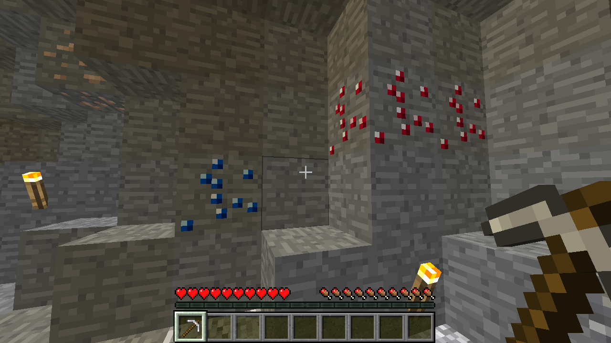
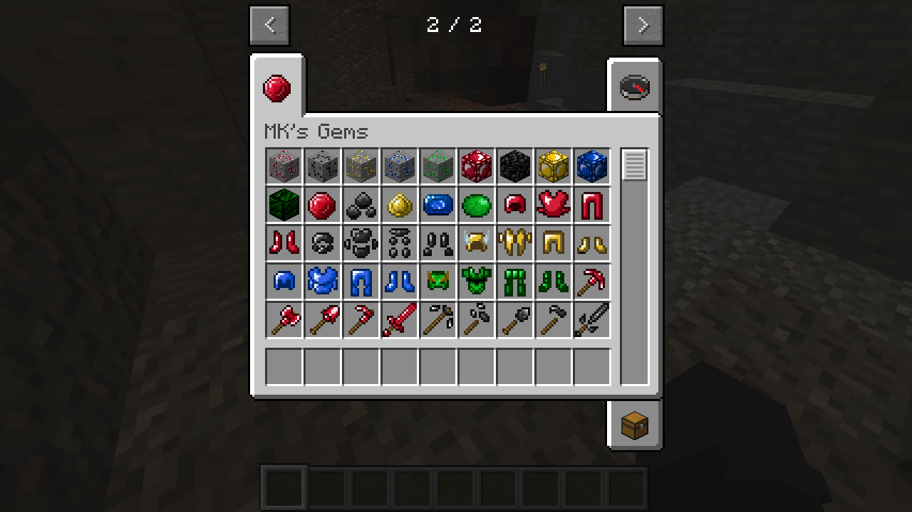
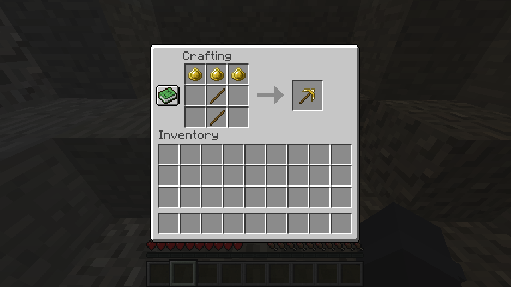
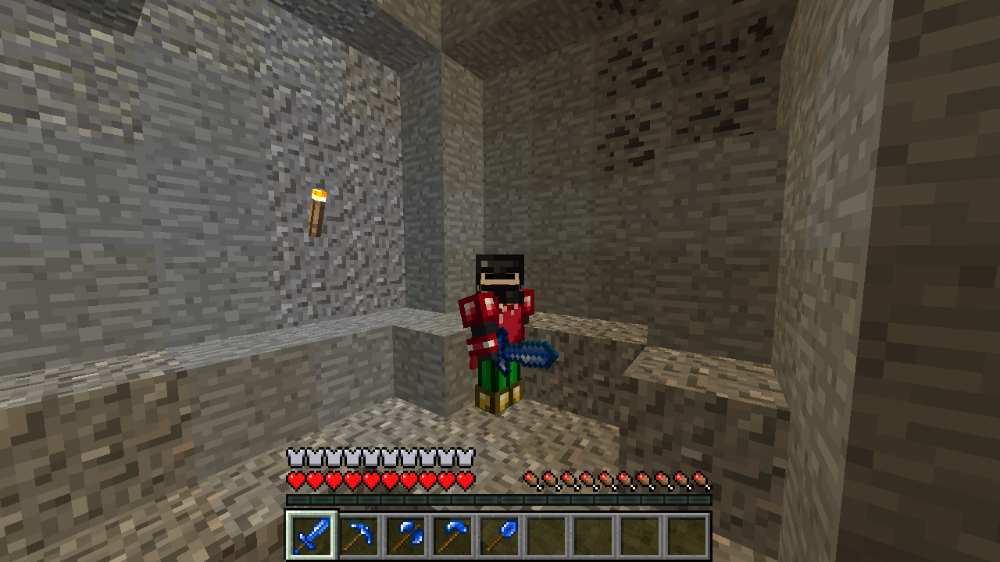

# Minecraft Gems Mod

![Java](https://img.shields.io/badge/Java-0074BD?logo=)
![Minecraft Forge](https://img.shields.io/badge/Minecraft%20Forge-1E2D44?logo=)


Minecraft 1.12.2 mod that adds new ores, tools and crafting recipes.

## Overview

The mod adds several new gem types, each with its own ore, tools, armor and crafting recipes. Every gem comes with full world generation and both English and Czech localization. Tools and armor are slightly stronger than diamond. Ores spawn in the Overworld between Y levels 5 and 30, at a rarity comparable to diamond, three veins per chunk, four blocks per vein.

## Tech stack

- **Language:** Java
- **Platform:** Minecraft Forge 1.12.2
- **Build:** Gradle

## Building from source
```sh
gradlew build
```

The compiled `.jar` ends up in `build/libs/`.

## Installation

1. Download the latest `.jar` from [Releases](https://github.com/mk-forge/minecraft-gems-mod/releases).
2. Place it in your `.minecraft/mods/1.12.2/` folder.
3. Launch Minecraft with the Forge 1.12.2 profile.

## Screenshots






## Credits

Textures for gems, tools and armor are based on assets from the [GemsPlusPlus](https://modrinth.com/mod/gemsplusplus) mod, licensed under [LGPL-3.0-only](https://www.gnu.org/licenses/lgpl-3.0.html).

## License

[MIT](LICENSE)